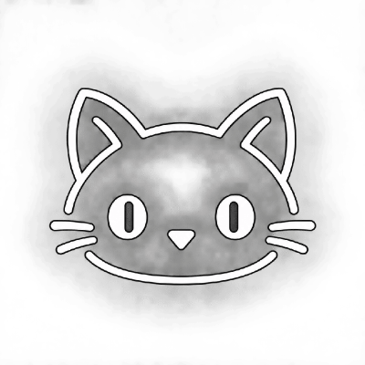
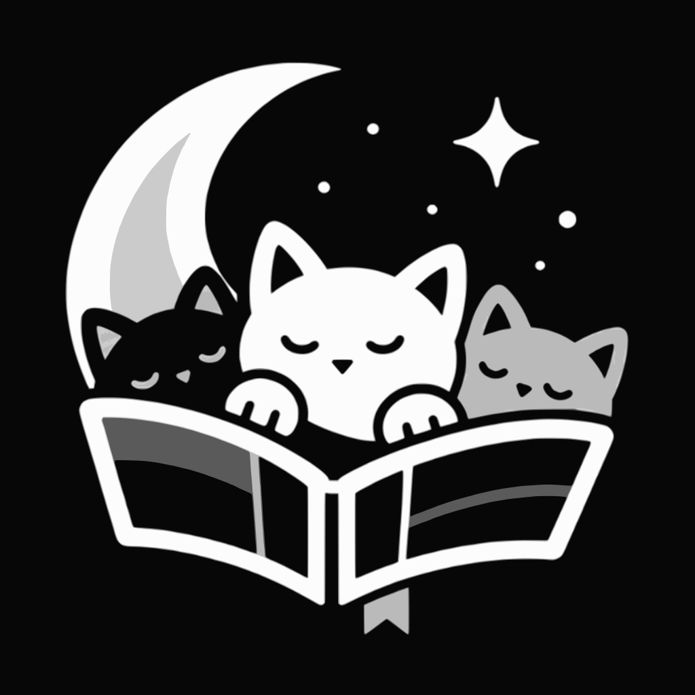

<h1> Moon Ecosystem</h1>

Thoughtfully designed Android apps for music, reading and everyday digital life.
No ads, no tracking, just apps that do their job.

## Apps

<table>
  <tr>
    <td align="center" width="33%">
      <h3><a href="https://github.com/Moon-Ecosystem/MoonReader"> Moon Reader</a></h3>
      A fast, offline manga and comic reader for CBZ and ZIP archives, with immersive reading modes, progress tracking and PIN protection.
        
      <a href="https://github.com/Moon-Ecosystem/MoonReader/releases/latest">Download</a> · <a href="https://moon-ecosystem.github.io/Moon-Reader-Website/">Website</a>
    </td>
    <td align="center" width="33%">
      <h3><a href="https://github.com/Moon-Ecosystem/MoonPlayer"> Moon Player</a></h3>
      A minimalist music player with a terminal-inspired UI, album-art accent colors and background playback.
        
      <a href="https://github.com/Moon-Ecosystem/MoonPlayer/releases/latest">Download</a>
    </td>
    <td align="center" width="33%">
      <h3><a href="https://github.com/Moon-Ecosystem/MoonKeyboard"> Moon Keyboard</a></h3>
      A fully offline keyboard with glide typing, autocorrect and next-word prediction in English and Hinglish. No internet permission.
        
      <a href="https://github.com/Moon-Ecosystem/MoonKeyboard/releases/latest">Download</a>
    </td>
  </tr>
</table>

## Principles

- **Private by default:** your data stays on your device.
- **Offline first:** the apps work without a connection.
- **Open source:** built with Kotlin and Jetpack Compose, in the open.

## Contact

Questions or ideas? Open an issue on the app's repo or email [moon.ecosytems@gmail.com](mailto:moon.ecosytems@gmail.com).
